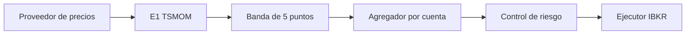

# investing

Esqueleto del sistema de trading de Daniel sobre Interactive Brokers, y la señal de la estrategia **E1 (TSMOM)** para ETFs UCITS en Xetra. Esta revisión calcula pesos. No abre TWS y no envía órdenes.

El backtest de referencia vive en el código del equipo (`bt/strategies.py`, `bt/engine.py`, `run_ibkr.py`). Los parámetros de E1 salen de ahí y del marco de riesgo v1.2: lookback 252, σ objetivo 10 %, tope 40 % por ETF, banda de 5 puntos, apalancamiento 1×. No se cambian desde la configuración.

## Qué hay en esta PR, y qué llega después

| Pieza | Estado | Dueño de la PR siguiente |
| --- | --- | --- |
| Paquete, configuración de las cuentas de 3.000 € y 10.000 €, logging JSON | Hecho | — |
| Contrato `TargetWeights` → agregador → riesgo → ejecutor | Hecho | — |
| Señal E1 y banda de no-operar | Hecho | — |
| Precios desde CSV | Hecho | — |
| Histórico IBKR (`reqHistoricalData`) | Stub `NotImplementedError` | Ejecución |
| Órdenes límite en Xetra, `whatIfOrder`, neteo contra la posición real, participaciones enteras, mínimo 500 € | Stub `NotImplementedError` | Ejecución |
| Kill switch y `riesgo.yaml` | Stub `NotImplementedError` | Riesgo |
| Candado de paper (rechazar el puerto live 7496) y `paper_vs_backtest.py` | Sin implementar | Paper |

Cualquier ciclo que fuera a mandar una orden llama antes a `ControlRiesgo.evaluar`. El stub de riesgo falla a propósito, así que con la configuración de esta PR el ejecutor no llega a construirse.

## Arquitectura



Los precios de los tests salen de `data/ucits_eur.csv`. El proveedor histórico de IBKR está en `investing.data.ibkr_historico` y no se llama desde el cálculo de la señal.

```
src/investing/
  contratos.py          TargetWeights, PesosCuenta, VeredictoRiesgo
  calendario.py         Xetra (órdenes) y EE. UU. (máscara del backtest)
  configuracion.py      YAML de cuentas
  flujo.py              orden obligatorio: señal, banda, agregador, riesgo, ejecutor
  strategies/e1_tsmom.py
  aggregator/agregador.py
  risk/control.py       stub
  execution/ejecutor.py stub
  data/csv_proveedor.py
  data/ibkr_historico.py stub
config/cuentas.ejemplo.yaml
data/ucits_eur.csv
```

## Contrato entre piezas

1. **Estrategia.** `senal(precios, fecha) -> TargetWeights`. El objeto lleva `estrategia`, `fecha_senal` y `pesos`: un diccionario símbolo → peso. Cada peso está en [0, 1] y la suma es ≤ 1. Lo que falta hasta 1 es caja. Un peso negativo es un corto y se rechaza: E1 no pone cortos.
2. **Banda.** Antes de agregar, cada símbolo se compara con el peso actual de esa sleeve. Si el signo no cambia y la distancia es ≤ 5 puntos porcentuales, se mantiene el peso actual. Si la distancia es mayor, o el signo cambia (entrar desde caja o volver a caja), se adopta el objetivo. Es la regla de `bt.engine.simulate`: la comparación es estricta (`>`), el signo del peso actual se redondea a 10 decimales, y el objetivo no. Una sleeve que después de la banda supere 1× se escala a la baja; el motor de backtest lo evita al no gastar una caja que no tiene, y aquí el tope entra en el propio vector de pesos.
3. **Agregador (uno por cuenta).** Peso neto de un símbolo = Σ presupuesto de la estrategia × peso en esa estrategia. El presupuesto es la fracción de riesgo de la cuenta (en la fase 1, 1.0 para la única sleeve). Si el bruto supera 1, se divide toda la cartera por ese bruto. `PesosCuenta` guarda también el desglose por estrategia, antes de esa escala, y el `factor_escala`.
4. **Riesgo.** `evaluar(cuenta, propuesta, pesos_actuales) -> VeredictoRiesgo`. La decisión es `permitir`, `reducir` (con los pesos ya recortados) o `vetar`. Un veto no llama al ejecutor. Los límites del marco (drawdown −12 / −18 / −25 %, oro, renta variable, orden mínima) se implementan en la PR de Riesgo.
5. **Ejecutor.** Recibe el veredicto y la fecha de ejecución (el día hábil de Xetra siguiente a la señal) y los convierte en órdenes. Rechaza un veto aunque alguien lo llame directo. El neteo contra las posiciones reales de IBKR, el redondeo a participaciones y `whatIfOrder` son de esa PR: el agregador ya entrega el neto entre estrategias, en pesos, no en títulos.

Las estrategias mensuales solo disparan el ciclo el último día hábil de Xetra. Un día intermedio termina en `sin_rebalanceo` y no consulta al riesgo, porque no hay orden.

## Señal E1

Universo, en EUR y en Xetra:

| Símbolo | Papel | Proxy del backtest | Yahoo en el CSV |
| --- | --- | --- | --- |
| SPYL | Renta variable, S&P 500 | SPY | SPYL.DE |
| PPFB | Oro físico | GLD | PPFB.DE |
| SXRM | Bonos del Tesoro USD 7-10 años | IEF | SXRM.DE |
| SXRS | Materias primas | DJP | SXRS.DE |

La cuenta de 3.000 € usa solo SPYL y PPFB. La de 10.000 € usa los cuatro. `N` es el número de columnas de esa variante, así que el mismo ETF no recibe el mismo peso en las dos cuentas: el 10 % de σ se reparte entre 2 o entre 4.

Para cada ETF, con la serie alineada (se tira cualquier sesión en la que falte un cierre del universo, igual que el `dropna()` de `run_ibkr.py`):

1. **Señal.** Retorno = cierre de hoy / cierre de hace 252 sesiones − 1. Si es positivo, largo; si no, peso 0. La ventana del backtest es `prices.shift(252)` sobre cierres diarios. Esa es la definición operativa de los 12 meses: el código de `e1_tsmom` no remuestrea a cierres de fin de mes, y un desacuerdo de signo entre las dos cuentas se resuelve a favor de las 252 sesiones.
2. **Volatilidad.** Desviación típica EWMA de los retornos diarios, `span=60`, `min_periods=60`, `adjust=True`, `ignore_na=False`, `std(bias=False)`, anualizada con √252. Son los argumentos con los que pandas ejecuta la llamada del backtest (`ewm(span=60, min_periods=60).std()`).
3. **Tamaño.** Peso bruto = señal × (0,10 / N) / σ. El σ de un ETF que está en caja no se reparte entre los que siguen largos.
4. **Tope por ETF.** Se recorta a 0,40.
5. **Tope de cartera.** Si la suma supera 1, se divide por esa suma. Si no, el resto queda en caja. No hay apalancamiento.

Hasta que existen 252 cierres alineados y 60 retornos para la EWMA, el peso de ese ETF es 0. Hace falta la serie entera: la EWMA con `adjust=True` usa toda la historia, no solo las últimas 60 sesiones.

El rebalanceo mensual toma el cierre de Xetra del último día hábil del mes. La orden, cuando la PR de Ejecución exista, es una límite del día hábil siguiente (`exec_lag=1` en el motor). El calendario de Xetra sigue los días sin negociación que publica Deutsche Börse: 1 de enero, Viernes Santo, Lunes de Pascua, 1 de mayo, 24, 25 y 26 de diciembre, y 31 de diciembre. Ascensión, Pentecostés, Corpus y el 3 de octubre son sesión.

El backtest marcaba el fin de mes con `USFederalHolidayCalendar`, porque las series largas eran proxies de EE. UU. `CalendarioEEUU.mascara_fin_de_mes` repite esa máscara para poder compararla. Las órdenes de los UCITS usan `CalendarioXetra`. En un mes en el que el festivo cae en sitios distintos (el 31 de diciembre, o el Memorial Day cuando cae en el último lunes de mayo) el cierre que entra en la señal es el de Xetra. El peso de una fecha concreta, dado el mismo histórico, es el del backtest; cambia el día elegido como cierre de mes.

La cartera K' del marco (10k al 50 % entre la variante de 4 y la de 2) no está activada en el ejemplo. El agregador ya suma sleeves si se declaran las dos estrategias con presupuesto 0,5; el bloque comentado de `config/cuentas.ejemplo.yaml` muestra cómo.

## Cómo calcular la señal

Hace falta Python 3.12 o posterior.

```bash
python -m venv .venv
source .venv/bin/activate
pip install -e .
pytest
```

La señal sobre el CSV adjunto, sin conectar a nada:

```bash
python -m investing --csv data/ucits_eur.csv --cuenta cuenta_3k
python -m investing --csv data/ucits_eur.csv --cuenta cuenta_10k --fecha 2025-12-30
```

`--fecha` es el cierre que entra en la señal (`YYYY-MM-DD`). Sin ella se usa el último cierre del fichero. Si ese día es el último hábil de Xetra, el programa dice qué día hábil siguiente llevaría la orden límite.

`--ciclo` recorre también riesgo y ejecutor. En esta PR el control de riesgo sigue siendo un stub: el proceso imprime el `TODO (Riesgo)` y termina sin orden. Sirve para ver que el flujo se detiene ahí.

Los logs van a stderr en JSON (`ts`, `nivel`, `logger`, `mensaje`, `campos`).

## Paper, cuando toque ejecutarlo

TWS o IB Gateway en modo **paper**, en la máquina de Daniel, puerto **7497**. El puerto live es el 7496 y no se usa. Esta revisión no tiene cliente: no instancia `IB`, no llama a `connect` y no importa `ib_async` (la dependencia está declarada para la PR de Ejecución). El candado que rechace una sesión que no sea paper, y la comparación `paper_vs_backtest.py`, llegan en la PR de Paper.

Hasta entonces, la única forma de correr el sistema es la de arriba: CSV local y pesos por stdout.
